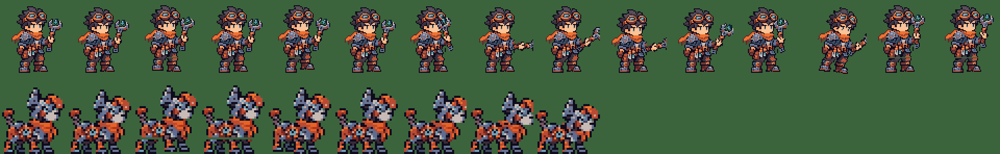
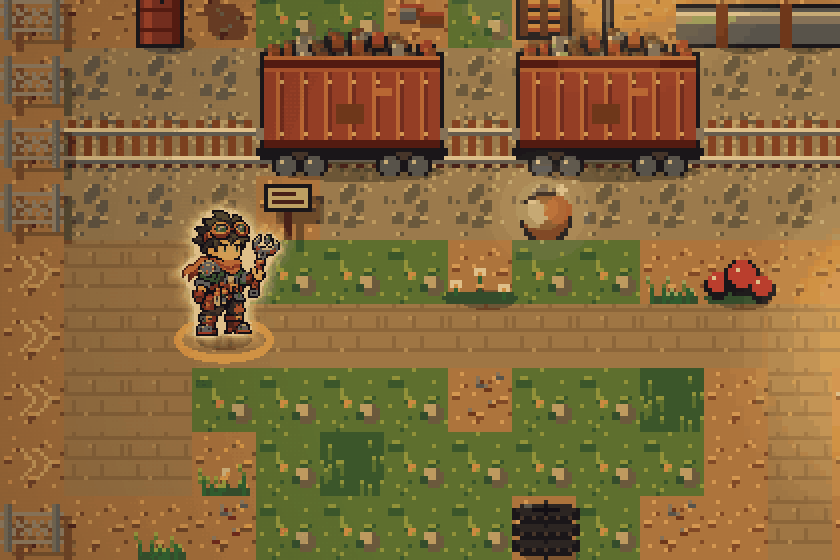
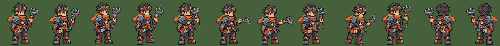

# Scrapo web — alpha

Branch `feat/alpha` (base `f024651`). Registro do que entrou no alpha, como foi validado e o que ficou pendente.

## Como rodar e validar

```bash
npm install
npm run dev            # http://localhost:5180
npx tsc --noEmit       # typecheck
npm test               # vitest, 27 testes de regras puras
npm run build          # tsc + vite build
npm run e2e            # Playwright: fluxo completo, QWER, save v1 (servidor próprio na porta 5190, sem HMR)
SCRAPO_AUTO_SOAK=1 npx playwright test e2e/auto.spec.ts   # 3 sessões de Auto de 5 min (≈16 min)
```

O E2E usa o Chrome instalado (`channel: 'chrome'`), cada teste tem `localStorage` isolado, e os resultados e capturas de falha ficam em `.snapshots/e2e-results/` (fora do git). As sessões de Auto gravam um relatório por linha em `.snapshots/auto-sessions.jsonl`.

## O que entrou

| Área | Mudança | Commit |
|---|---|---|
| Base | Estado jogável salvo antes do alpha | `f024651` |
| Herói e Ferrugem | Arte de referência do usuário convertida em pixel art (`tools/pixelize-ref.py`) e assada em spritesheets (`tools/bake-sprites.py`): herói com repouso, caminhada, ataque, coleta, dano, esquiva e conjuração (15 quadros); Ferrugem com repouso, corrida, mordida e busca (9 quadros). Dano do golpe e da mordida cai no quadro de impacto; a batida da coleta acompanha a faísca. | `3167dc7` |
| Auto | Sai de travas (ordem parada 1,5 s → descarta e põe o alvo de castigo por 20 s); do Pátio vai sozinho ao ferro-velho; confirma modais de história após 4 s; esquiva golpes telegrafados, recua com vida baixa; usa as mesmas habilidades e recargas do manual; qualquer entrada manual assume na hora. Contadores de QA em `session.autoLog`. | `bbdd8a3` |
| HUD | R virou **Sobrecarga** (apagado sem drone); cada botão do rodapé tem ícone de habilidade em pixel art; Q/W/E/R não disparam mais com 1–4 (que trocam ferramenta). | `bbdd8a3` |
| Inimigos | Triador e prensa redesenhados; novos: faiscador (investida curta), magnetron (projétil esquivável após linha de mira), golem de sucata (pancada no chão com anel largo); quebram em sucata ao morrer. | `f015e4f` |
| Ambiente | Pedras com musgo, troncos, cogumelos, flores, cercas vivas, pisos refeitos, barra de vida com medalhão (entregue antes do alpha, na base). | `f024651` |
| Ícones | 21 ícones de itens redesenhados no estilo da referência 08; contador de créditos pulsa ao vender. | registro final |
| Auto (2ª rodada) | Castigo para inimigos inalcançáveis; sai de mapa esgotado. | registro final |
| Herói adulto | Pedido do usuário (visual infantil): `tools/adultify-hero.py` refaz a base a partir da mesma referência com cabeça ~25% menor, corpo mais longo, olhos pequenos e escuros e paleta dessaturada/envelhecida; mesma folha de 20 quadros. | registro final |
| Vistas de costas e de lado | Quadros 15–19 (costas) e 20–24 (lado) gerados da arte base; animações escolhidas pela direção do movimento. | registro final |
| Docs | README documenta T, Auto e Ferrugem; este arquivo. | `bbdd8a3` e registro final |

### Arte externa (busca e decisão)

Busca feita em 2026-11-19 por packs CC0/CC BY de sucata e ferro-velho top-down 16x16 (OpenGameArt):

| Candidato | Licença | Decisão |
|---|---|---|
| [Volt Scrap art](https://opengameart.org/node/173323) | CC0 | Não importado: paleta DB32 e traço de game jam destoam do herói convertido e das props com rampas de 3 tons. |
| [Dungeon tileset com props](https://opengameart.org/node/21239) | CC0 | Não importado: tema de masmorra medieval, sem sucata. |
| [Top-down 16x16](https://opengameart.org/node/155014) | CC0 | Não importado: sem props de sucata identificáveis. |
| [16x16 Tiny Top Down Pack](https://opengameart.org/node/140355) | não informada na página de busca | Descartado por licença não confirmada. |

Resultado: nenhum asset de terceiros entrou; toda a arte vem das referências do usuário (`assets-src/ref/`, convertidas por `tools/pixelize-ref.py` e `tools/bake-sprites.py`) ou é pintada em código. Não há créditos de terceiros a registrar. Nenhum script de pack foi baixado ou executado.

## Capturas

| Antes (herói pintado em código, 24×32) | 1ª conversão (quadros herói 15, Ferrugem 9) | 1ª conversão no jogo, zoom 2 | Versão adulta final (repouso, caminhada, ataque, coleta, dano, esquiva, habilidade, costas) |
|---|---|---|---|
|  |  |  |  |

Sequência de animação conferida por amostragem dos quadros em execução: `hero-attack 6→7→8`, `hero-cast 13→14`, `hero-dash 12`, de volta a `hero-idle 0`; escala restaurada a 0,5 depois das animações.

## Validação

| Verificação | Resultado |
|---|---|
| `npx tsc --noEmit` | limpo |
| `npm test` | 27 passaram |
| `npm run build` | ok |
| E2E fluxo completo (save novo): explorar → vasculhar o 1º vagão → coletar com Auto → equipar ferramenta → montar módulo e drone → iniciar extração → fechar a aba → reabrir → recolher uma vez → recarregar sem recolher de novo → vender | passou (≈40 s) |
| E2E Q/W/E/R com recargas na masmorra | passou |
| `npx playwright test` (suíte inteira no commit final; sessões longas opcionais ficam como skipped) | 3 passaram, 3 skipped |
| E2E save versão 1 de build anterior | passou (migra para v2, mantém créditos e itens) |
| Console durante os E2E | sem erros |
| Auto, 1 min por sessão (fumaça) | 3/3; 0 travas, 0 mortes; s1 72 itens, s2 4 abates e 17 esquivas, s3 7 abates e 3 Sobrecargas |
| Auto, 5 min por sessão | 3/3, 0 travas, 0 mortes (tabela abaixo) |

### Sessões de Auto (5 min)

Rodada final (`SCRAPO_AUTO_SOAK=1 npx playwright test e2e/auto.spec.ts`, 3 passaram em 15,2 min). "Trava" = herói parado 30 s+ sem vasculhar, sem trocar de mapa e sem modal.

| Sessão | Mapas | Itens | Abates | Esquivas | Habilidades (Pulso/Arco/Investida/Sobrecarga) | Recuos | Destravas | Vida mín. | Mortes | Travas | Erros de console |
|---|---|---|---|---|---|---|---|---|---|---|---|
| s1 ferro-velho, sem drone | yard | 409 | 6 | 9 | 0 / 6 / 9 / 0 | 0 | 1 | 65 | 0 | 0 | 0 |
| s2 masmorra, sem drone | dungeon → yard | 344 | 28 | 22 | 11 / 28 / 34 / 0 | 27 | 0 | 7 | 0 | 0 | 0 |
| s3 masmorra, com drone | dungeon → yard | 456 | 13 | 13 | 1 / 16 / 14 / 5 | 0 | 0 | 35 | 0 | 0 | 0 |

Essa é a 3ª rodada, sobre a árvore de `0112ba2` (lógica de jogo final; a troca seguinte do herói adulto só muda arte, com a mesma geometria de quadro, e foi revalidada pelos E2E). A 2ª rodada, logo após a correção, também deu 3/3 sem travas (382/390/446 itens, vida mínima 86/12/1).

Rodada anterior: s3 teve 2 travas (masmorra esgotada sem plano B e perseguição de alvo inalcançável). Correção: inimigos inalcançáveis ficam 15 s de castigo, e sem trabalho no mapa o Auto segue para o outro mapa. A vida mínima de 7 (e 1 na 2ª rodada) mostra que o risco de morrer continua real.

## Pendências

1. **Estilo do herói**: versão adulta aplicada (ver tabela). Se o usuário gerar uma nova referência, basta trocar o arquivo e rodar `python tools/adultify-hero.py <ref>` (ou `pixelize-ref.py` para manter proporções) seguido de `python tools/bake-sprites.py`.
2. Herói tem três vistas derivadas da mesma arte: frente (0–14), costas (15–19, rosto vira nuca) e lado (20–24, cabeça à frente, tronco estreitado, olho distante oculto; espelhada para a esquerda). Conferido no navegador: andar à esquerda/direita usa `hero-walk-side`, para cima `hero-walk-up`, para baixo `hero-walk`, parado de lado `hero-idle-side`. Um perfil pintado à mão ou gerado continua sendo uma melhoria possível, e a aprovação visual final do herói adulto é do usuário.
3. A extração AFK conta ciclos só com a aba aberta; ao fechar, guarda os ciclos concluídos (decisão de design original, coberta pelo E2E).
4. Inimigos novos são pequenos no zoom 2; avaliar escala depois de o usuário jogar.
5. Em espera neste alpha: Ferromancia (sessão própria em `feat/ferromancia`), Kick e backend.
